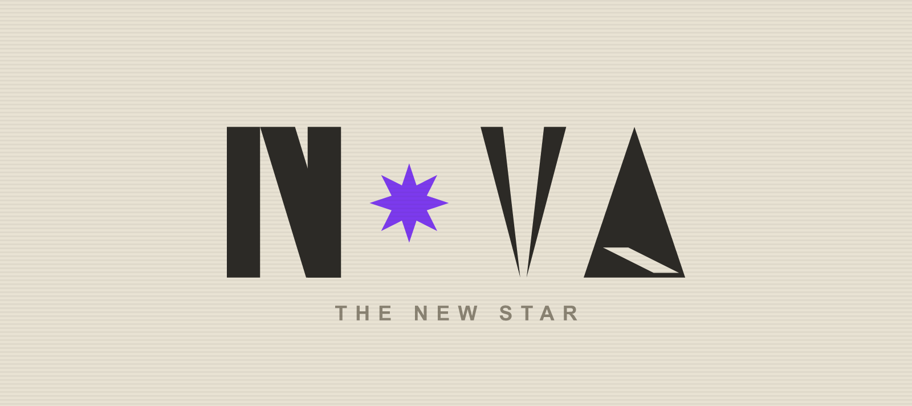
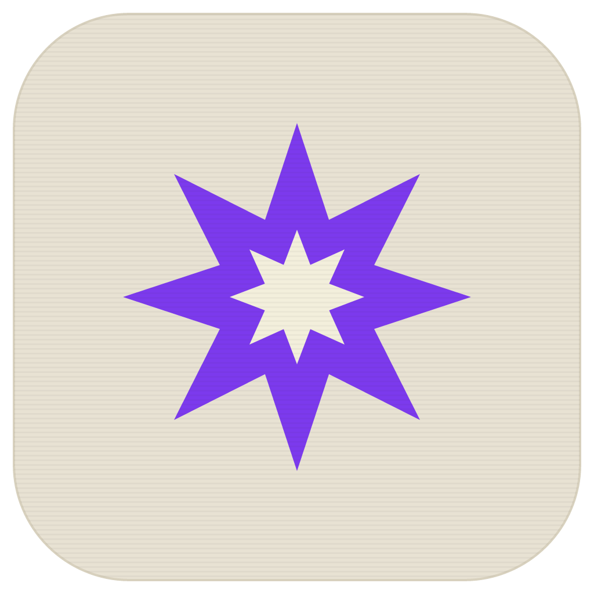

  

# NOVA — THE NEW STAR

Mensajería privada para dos personas, con la calidad que las apps de mensajería actuales han dejado de ofrecer.

## Por qué NOVA

Existen muchas aplicaciones de mensajería, pero casi ninguna pensada realmente para lo que necesitamos: comunicación privada, simple y directa entre dos personas. La mayoría son servicios masivos que venden tu información, llenos de ruido, funciones innecesarias y una calidad que se degrada con el tiempo.

**NOVA viene a mejorar eso.** No reinventamos la rueda: tomamos lo que funciona y lo hacemos bien, con una experiencia cuidada, sin spam, sin telemetría invasiva y con una estética propia. Una herramienta personal que prioriza la calidad sobre la escala.

## Estado del proyecto

Este es un **proyecto personal** que se irá **mejorando con el tiempo**. Empieza como una app de escritorio para dos personas, y crece a medida que se pulen detalles, se añaden funciones y se refina la experiencia.

 

  

